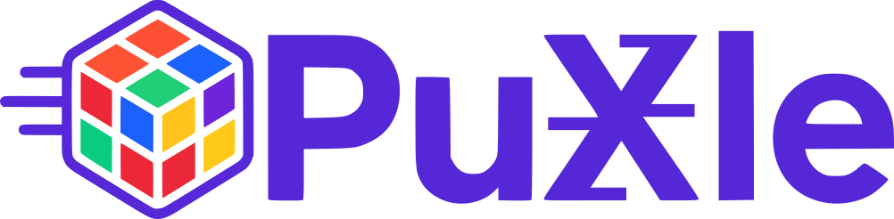

<div align="center">
  
</div>

# **PuXle**: **P**lanning **u**sing ja**X**-based **l**earning **e**nvironments

[](https://opensource.org/licenses/MIT)
[](https://tinker495.github.io/PuXle/)

**PuXle** is a high-performance library for parallelized planning and puzzle environments built on JAX. It provides a comprehensive collection of classic puzzles and external ecosystem adapters (PDDL and Cayley/Schreier graphs) optimized for AI research, reinforcement learning, and search algorithms. PuXle leverages [Xtructure](https://github.com/tinker495/Xtructure.git) as a backend for JAX-optimized data structures, offering advantages such as efficient batched operations, GPU-accelerated priority queues and hash tables for faster planning and puzzle solving in AI research. PuXle serves as the planning and puzzle implementation backend for [JAxtar](https://github.com/tinker495/JAxtar), enabling JAX-native parallelizable A* and Q* solvers for neural heuristic search research.

## 🚀 Features

- **High Performance**: JAX-powered parallelization for lightning-fast planning and puzzle solving
- **Optimized Data Structures**: Powered by Xtructure for efficient batched operations, GPU-accelerated priority queues, and hash tables
- **Diverse Environments**: 11 classic native puzzles plus external adapters for PDDL and [cayleypy](https://github.com/cayleypy/cayleypy)
- **AI Research Ready**: Built for reinforcement learning, heuristic search algorithms, and world-model research
- **Batch Processing**: Efficient batch operations for training and evaluation
- **Extensible**: Easy-to-extend base classes for creating new puzzle and planning environments
- **GPU Acceleration**: Full GPU support through JAX

## 📚 Documentation

Full API documentation is automatically built and deployed to **[GitHub Pages](https://tinker495.github.io/PuXle/)** on every push to `main`.

- **[API Reference](https://tinker495.github.io/PuXle/api/index.html)** — All modules, classes, and functions
- **Bitpacked runtime states (xtructure)**: [`docs/tutorials/xtructure_bitpacking.md`](docs/tutorials/xtructure_bitpacking.md)
- **PDDL planning domains**: [`docs/tutorials/pddl_planning.md`](docs/tutorials/pddl_planning.md)
- **cayleypy bridge — Cayley/Schreier graphs as PuXle puzzles**: [`docs/tutorials/cayley_bridge.md`](docs/tutorials/cayley_bridge.md)

## 📦 Installation

Add the latest GitHub revision to a uv project (all runtime features — classic
puzzles, PDDL, Cayley, world models, and visualization — are included by
default):

```bash
uv add "puxle @ git+https://github.com/tinker495/PuXle.git"
```

Optional hardware/docs extras:

```bash
uv add "puxle[cuda] @ git+https://github.com/tinker495/PuXle.git"
uv add "puxle[docs] @ git+https://github.com/tinker495/PuXle.git"
```

For development from a checkout:

```bash
git clone https://github.com/tinker495/PuXle.git
cd PuXle
uv sync --group dev
```

Puzzle utilities are available through the package CLI:

```bash
uv run puxle human-play --puzzle SlidePuzzle --puzzle-args '{"size": 4}'
uv run puxle world-model-train --help

# From a source checkout
uv run python main.py --help
```

## 🎯 Quick Start

```python
import jax
from puxle import RubiksCube, SlidePuzzle, Sokoban

# Initialize a puzzle
puzzle = RubiksCube()
key = jax.random.PRNGKey(42)

# Get solve configuration and initial state
solve_config, initial_state = puzzle.get_inits(key)

# Get available actions
neighbors, costs = puzzle.get_neighbours(solve_config, initial_state)

# Check if solved
is_solved = puzzle.is_solved(solve_config, initial_state)
print(f"Initial state solved: {is_solved}")

# Render terminal diagram and RGB image array
print(initial_state.str(solve_config=solve_config))
image = initial_state.img()
print(f"State visualization shape: {image.shape}")
```

## 🧩 Available Environments

### Classic Puzzles

| Puzzle | Description | Difficulty |
|--------|-------------|------------|
| **RubiksCube** | Classic N×N×N Rubik's Cube | Hard |
| **SlidePuzzle** | N×N sliding tile puzzle | Medium |
| **Sokoban** | Box-pushing warehouse puzzle | Hard |
| **TowerOfHanoi** | Classic disk-moving puzzle | Medium |
| **LightsOut** | Toggle lights to turn all off | Medium |
| **Maze** | Navigate through a randomly generated DFS maze | Easy-Medium |
| **Room** | Multi-room grid navigation puzzle | Easy-Medium |
| **TSP** | Traveling Salesman Problem | Hard |
| **PancakeSorting** | Sort pancakes by prefix flipping | Medium |
| **TopSpin** | Circular track and turnstile puzzle | Medium |
| **DotKnot** | Color-pair path connection puzzle | Medium |

### External Ecosystem Adapters

| Adapter | Description | Presets & Discovery | Guide |
|---------|-------------|---------------------|-------|
| **PDDL** | STRIPS planning domains with bit-packed grounded atoms | `PDDLPresets`, `PDDL.list_sources()` | [`docs/tutorials/pddl_planning.md`](docs/tutorials/pddl_planning.md) |
| **CayleyPuzzle** | [cayleypy](https://github.com/cayleypy/cayleypy) permutation & matrix Cayley/Schreier graphs | `CayleyPresets`, `CayleyPuzzle.list_sources()` | [`docs/tutorials/cayley_bridge.md`](docs/tutorials/cayley_bridge.md) |

## 📚 Advanced Usage

### Batch Processing

```python
import jax
import jax.numpy as jnp

# Process multiple puzzle instances simultaneously
batch_size = 1000
keys = jax.random.split(jax.random.PRNGKey(0), batch_size)

# Generate batch of initial states
solve_configs = jax.vmap(lambda k: puzzle.get_solve_config(k))(keys)
initial_states = jax.vmap(lambda sc, k: puzzle.get_initial_state(sc, k))(solve_configs, keys)

# Batch solve checking with multiple solve configs
solved_states = puzzle.batched_is_solved(solve_configs, initial_states, multi_solve_config=True)
print(f"Solved states in batch: {jnp.sum(solved_states)}")

# Alternative: Use single solve config for all states
single_solve_config = puzzle.get_solve_config(jax.random.PRNGKey(42))
solved_states_single = puzzle.batched_is_solved(single_solve_config, initial_states, multi_solve_config=False)
print(f"Solved states with single config: {jnp.sum(solved_states_single)}")
```

### SolveConfig Structure

`get_inits(key)` continues to return `(solve_config, initial_state)`. Every
`SolveConfig` has exactly two outer fields:

- `InstanceContext`: data that can change action validity, transitions, or edge costs.
- `GoalSpec`: data that defines the solved predicate, reward, or utility.

When a goal is one complete state, `GoalSpec` is exactly the puzzle's `State`
class and `solve_config.GoalSpec` is the target state. Accordingly,
`has_target` means `GoalSpec is State`; `has_goal_data` means that the goal
specification stores data leaves.

| Environment | `InstanceContext` | `GoalSpec` |
|---|---|---|
| Default target puzzle | Empty | Target `State` |
| Maze | Packed maze layout | Target `State` |
| TSP | Points, distance matrix, start index | Empty |
| PDDL | Grounded precondition/effect masks | Goal mask |
| DotKnot or another goal-free environment | Empty | Empty |

Environment-specific data is available only through these two children; the
outer `SolveConfig` does not expose compatibility aliases.

### Custom Environment Creation

```python
import jax
import jax.numpy as jnp
from puxle import Puzzle
from xtructure import FieldDescriptor, Xtructurable


class CustomPuzzle(Puzzle):
    action_size = 4  # Number of possible actions

    def define_state_class(self):
        class State(Xtructurable):
            position: FieldDescriptor.tensor(dtype=jnp.int32, shape=(2,))  # Current position

        return State

    def get_solve_config(self, key=None, data=None):
        return self.SolveConfig(
            InstanceContext=self.InstanceContext(),
            GoalSpec=self.State(position=jnp.array([0, 0])),
        )

    def get_initial_state(self, solve_config, key=None, data=None):
        # Define initial state
        return self.State(position=jnp.array([5, 5]))

    def get_neighbours(self, solve_config, state, filled=True):
        # Define valid moves: up, down, left, right
        moves = jnp.array([[0, 1], [0, -1], [-1, 0], [1, 0]])
        new_positions = state.position[None, :] + moves

        # Create next states
        next_states = jax.tree_util.tree_map(lambda x: jnp.repeat(x[None, :], 4, axis=0), state)
        next_states = next_states.replace(position=new_positions)

        # All moves have cost 1
        costs = jnp.ones(4)

        return next_states, costs

    def get_string_parser(self):
        # Required: Return function to convert state to string
        def string_parser(state):
            return f"Position: ({state.position[0]}, {state.position[1]})"

        return string_parser

    def get_img_parser(self):
        # Required: Return function to convert state to image array
        def img_parser(state):
            # Create a simple 10x10 grid visualization
            grid = jnp.zeros((10, 10, 3))
            x, y = state.position
            # Place a marker at current position (clamp to grid bounds)
            x = jnp.clip(x, 0, 9)
            y = jnp.clip(y, 0, 9)
            grid = grid.at[y, x].set(jnp.array([1.0, 0.0, 0.0]))  # Red dot
            return grid

        return img_parser
```

## 🔧 API Reference

### Core Classes

- **`Puzzle`**: Base class for all puzzles and planning environments
- **`SolveConfig`**: Fixed `InstanceContext` and `GoalSpec` composition

### Key Methods

- **`get_inits(key)`**: Get `(solve_config, initial_state)`
- **`get_neighbours(solve_config, state)`**: Get valid next states and costs
- **`is_solved(solve_config, state)`**: Check if puzzle/planning goal is satisfied
- **`batched_*`**: Batch versions of core methods for parallel processing

## 🧪 Testing

Run the test suite:
```bash
pytest tests/
```

Run with coverage:
```bash
pytest --cov=puxle tests/
```

## 📄 License

This project is licensed under the MIT License - see the [LICENSE](LICENSE) file for details.

## See Also

- [Xtructure](https://github.com/tinker495/Xtructure): JAX-optimized data structures used as a backend for PuXle.
- [JAxtar](https://github.com/tinker495/JAxtar): JAX-native parallelizable A* and Q* solver that uses PuXle as its planning and puzzle implementation backend.
- [cayleypy](https://github.com/cayleypy/cayleypy): Library of Cayley/Schreier graph definitions consumed by [`CayleyPuzzle`](docs/tutorials/cayley_bridge.md).

## 🤝 Contributing and Feedback

We welcome contributions, bug reports, and feature requests! Since the author is still learning about this research field, we particularly appreciate feedback and suggestions for improvements from the community. Please feel free to:

- Open issues for bugs or feature requests
- Submit pull requests with improvements
- Share your research use cases and requirements

Your input helps make PuXle better for the entire AI research community!
